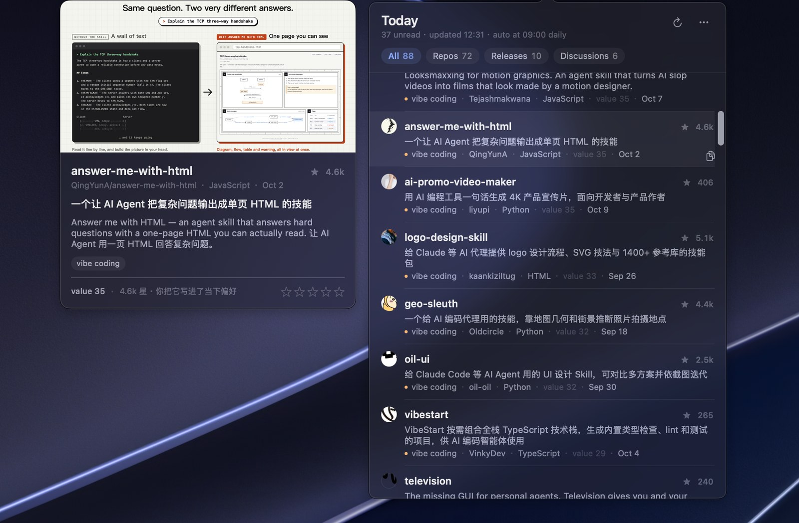

# OpenFeed

A macOS menu-bar feed for people who read GitHub for a living. Every morning it pulls what shipped and what is climbing, keeps the few items that match the lanes you care about, and gets out of the way.



<sub>Same panel without the hover card, dark and light: [`panel-dark-en.png`](assets/shots/panel-dark-en.png) · [`panel-light-en.png`](assets/shots/panel-light-en.png).</sub>

## Why

GitHub search answers "what exists". What you need each morning is "what changed, and of that, what deserves ten minutes". OpenFeed fetches on a schedule, dedupes against everything it has already shown you, scores what is left, and caps the day at sixty rows. You get a short list, not another firehose.

- **Hover a row** — a card shows the repository's key image from its README, a one-line summary of what it actually does, and the two reasons it scored where it did.
- **Click** — opens it in the browser.
- **Five stars under the card** — rating the row retrains the ranking; so does dragging a row above another.
- **Preferences you can read** — a plain Markdown file, one line per thing you care about. No hidden weights to reverse-engineer.

## Requirements

- macOS 13 or later
- Xcode command line tools (Swift 5.9+)

## Install

```bash
git clone https://github.com/<you>/openfeed.git
cd openfeed
./scripts/build-app.sh      # builds and copies to /Applications/OpenFeed.app
open -a OpenFeed
```

The app registers a login item on first launch and fetches immediately. Everything it fetches is stored locally; nothing is uploaded anywhere.

## Configure

The whole feed is defined by one JSON file, `~/Library/Application Support/OpenFeed/config.json` (menu: **关注列表…**). A minimal version:

```json
{
  "hour": 9,
  "queries": [
    { "lane": "智能体", "q": "topic:ai-agents stars:>200 created:>{since}" },
    { "lane": "智能体", "q": "topic:ai-agents stars:>2000 pushed:>{recent}", "sort": "updated", "needsAuth": true },
    { "lane": "本地优先", "q": "topic:local-first stars:>300 created:>{since}",
      "days": 60, "limit": 8, "must": ["local-first", "offline", "crdt"] }
  ],
  "releases": ["vercel/ai", "openai/codex"],
  "stories": ["AI coding agent"],
  "exploreLanes": ["本地优先"],
  "laneKeywords": { "本地优先": ["离线", "local-first"] }
}
```

| field | meaning |
| --- | --- |
| `lane` | The heading this query's hits are filed under. Pick your own names. |
| `q` | GitHub search syntax. `{since}` becomes `days` ago, `{recent}` becomes 7 days ago. |
| `sort` | `stars` (default) for new repos, `updated` for "still climbing" — the latter only stores a star baseline and surfaces a repo again once it gains 300+ stars locally. |
| `days` / `limit` | Search window in days, and how many hits this query may contribute. |
| `must` | At least one of these must appear in the repo's name, description or topics. Topics are self-declared, so without this gate a query like "knowledge graph" drags in exam-prep repos. |
| `needsAuth` | Skipped when no GitHub token is configured (unauthenticated search is 10 requests/minute). |
| `releases` | Repositories whose releases you want (atom feed, does not spend search quota). |
| `stories` | Hacker News keywords. |
| `exploreLanes` | Lanes you did not ask for. Their rows are dimmed, tagged `探索`, ranked slightly lower, and promoted automatically once you open or drag them. |
| `laneKeywords` | Optional words per lane. Without it, a lane is recognised in `preferences.md` by its own name. |
| `uiLang` | `"en"` or `"zh"` for the interface and the model-written summaries. Empty follows the system language. |
| `llmBaseURL` / `llmModel` | Any OpenAI-compatible `/chat/completions` endpoint, e.g. `https://api.deepseek.com` + `deepseek-chat`, or a local Ollama / LM Studio server. Left empty, nothing is sent and rows show the repository description as-is. |

### Preferences

`~/Library/Application Support/OpenFeed/preferences.md` is plain text you edit by hand (menu: **当下偏好…**). Lines starting with `★` count as "what I want most right now"; plain `-` lines count as "also on my radar". Mentions of a lane (by name, or by any word in `laneKeywords`) tilt that lane's weight in the score, normalised so the most-mentioned lane gets the largest tilt. Edit, then the next fetch re-ranks.

### Tokens

- **GitHub** (optional, raises search from 10 to 30 requests/minute): `GITHUB_TOKEN` / `GH_TOKEN` environment variable, a token saved in the menu, or your local `gh auth token`.
- **DeepSeek** (optional, powers the one-line summaries): `OPENFEED_LLM_KEY` or `DEEPSEEK_API_KEY`, or save a key in the menu. Without it you still get the feed — rows fall back to the repository description.

## Where the data lives

State, all local:

- `~/Library/Application Support/OpenFeed/` — `config.json`, `preferences.md`, `feed.json` (current panel), `seen.json` (every repo it has seen, with the star count at that time), `prefs.json` (learned weights), `summaries.json`, `ratings.json`.
- `~/Library/Caches/OpenFeed/` — downloaded images, READMEs, avatars. Safe to delete; re-fetched on demand. Images are pruned to the current and previous day after every fetch, so the cache does not grow without bound.

Deleting `seen.json` makes the app forget every repository it has seen.

## Development

```bash
swift build -c release --scratch-path ~/Library/Caches/openfeed-build/swiftpm

OpenFeed --probe --fetch                    # fetch once, print per-query hit counts
OpenFeed --probe --snapshot /tmp/shots      # render the panel offscreen, dark + light
OpenFeed --probe --dump --schedule          # read what is on disk, plus the 9am rule cases
OpenFeed --probe --images                   # time image resolution for the top rows
```

The interface is bilingual (English and Chinese) and follows the system language. Switch it in the menu — **Language** → *Follow system / English / 中文* — or pin it with `uiLang` in `config.json`. Model-written one-liners follow the same setting, and cached ones are kept per language so a switch never leaves Chinese text in an English panel. `OPENFEED_LANG=en` overrides everything, which is how the screenshots above were rendered.

## License

MIT — see [LICENSE](LICENSE).
